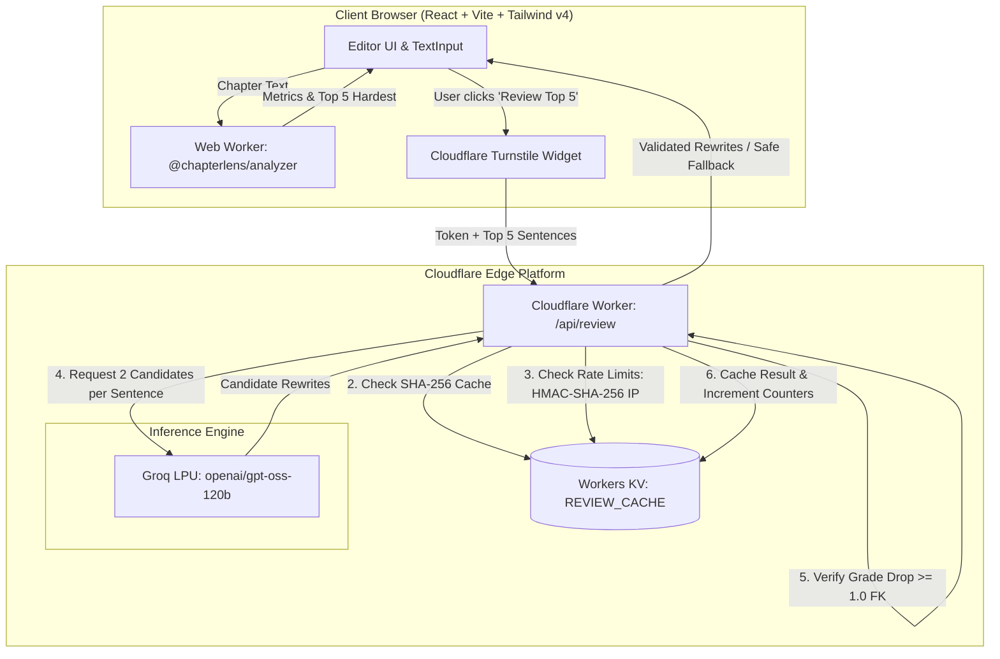

# ChapterLens 📖🔍

> **Chapter Readability Checker**: Paste a book chapter, inspect real-time readability metrics and sentence difficulty highlights, and optionally request AI-powered sentence rewrites with automated grade-improvement verification.

---

## Overview

ChapterLens is a privacy-first web application designed for fiction and non-fiction authors, editors, and publishers. It identifies stylistic and syntactic complexity within long texts (up to 200,000 characters), calculates comprehensive readability indices, highlights the five hardest sentences in the chapter, and offers optional AI rewrites backed by Cloudflare Workers and Groq LPU inference.

### Core Features

- **Instant Client-Side Readability**: Flesch Reading Ease, Flesch–Kincaid Grade Level, qualitative difficulty rating, word count, sentence count, and paragraph metrics computed asynchronously in a dedicated Web Worker.
- **Top 5 Sentence Difficulty Scoring**: Custom multi-factor composite heuristic (sentence length, syllable density, poly-syllabic word concentration, and comma/clause structure) that pinpoints the densest sentences.
- **Visual Highlighting & Interactive Jump-To**: Direct bidirectional navigation between ranked sentence cards and in-text highlight markers without innerHTML injections.
- **Verified AI Rewrite Suggestions**: Powered by Groq LLMs (`openai/gpt-oss-120b`). Every rewrite candidate is scored by the edge Worker and accepted only if it improves readability by at least **1.0 Flesch–Kincaid grade level**; otherwise, an automated single-pass retry is performed or a safe fallback badge is shown.
- **Privacy-First Zero-Logging Architecture**: Whole chapters remain strictly in your browser. Only the top 5 complex sentences are transmitted upon explicit user confirmation with Turnstile bot protection.
- **Abuse Prevention & Edge Caching**: 7-day content-hashed KV cache, HMAC-SHA-256 IP anonymization, per-IP daily quotas, and global daily circuit breakers.

---

## System Architecture



---

## Project Structure

This monorepo is managed with `pnpm workspaces`:

```text
chapterlens/
├── .github/workflows/
│   └── deploy.yml              # CI/CD: lint, test, eval, and Cloudflare Worker deploy
├── packages/
│   └── analyzer/               # Pure ES module readability engine (zero DOM dependencies)
│       ├── src/
│       │   ├── normalize.js    # Smart quotes, nbsp, and line normalization
│       │   ├── segment.js      # Sentence segmentation with dialogue & abbreviation patches
│       │   ├── syllables.js    # Syllable counter wrapper
│       │   ├── metrics.js      # Flesch Reading Ease & Flesch-Kincaid formulas
│       │   ├── difficulty.js   # Multi-factor sentence ranking
│       │   ├── schemas.js      # Zod validation schemas
│       │   └── index.js        # Public barrel exporting analyze() and scoreSentence()
│       └── test/               # Comprehensive unit test suite
├── apps/
│   └── app/                    # Client UI & Cloudflare Worker API
│       ├── src/                # React 19 UI with Tailwind CSS v4
│       ├── worker/             # Hono-based Cloudflare Worker (/api/review, /api/health)
│       │   ├── lib/            # Cache, Groq client, validation schemas
│       │   └── middleware/     # Cloudflare Turnstile & HMAC rate limiting
│       ├── wrangler.jsonc      # Cloudflare Worker & KV configuration
│       └── test/               # Component & Worker integration tests
├── evals/                      # Readability benchmarking & regression suite
│   ├── passages/               # 10 public-domain passages across reading levels
│   ├── expected/               # Golden analyzer baselines & independent textstat scores
│   ├── ATTRIBUTION.md          # Provenance & public domain licensing details
│   ├── eval.test.js            # Regression test suite (pnpm eval)
│   └── eval-ai.test.js         # Opt-in AI evaluation suite (pnpm eval:ai)
├── .dev.vars.example           # Template for Worker secrets
└── .env.example                # Template for frontend environment variables
```

---

## Environment Variables & Secrets Reference

### 1. Worker Secrets (Local: `apps/app/.dev.vars` | Production: `wrangler secret put`)

| Variable | Secret? | Destination | Description |
|---|---|---|---|
| `GROQ_API_KEY` | **Yes** | `.dev.vars` / Cloudflare Secret | Groq API key for LPU inference. |
| `TURNSTILE_SECRET` | **Yes** | `.dev.vars` / Cloudflare Secret | Cloudflare Turnstile secret key for server-side token validation. |
| `IP_HASH_SALT` | **Yes** | `.dev.vars` / Cloudflare Secret | Cryptographic salt used for HMAC-SHA-256 IP address hashing (`openssl rand -hex 32`). |

### 2. Client Build Variables (Local: `apps/app/.env.local` | Production: GitHub Actions Var)

| Variable | Secret? | Destination | Description |
|---|---|---|---|
| `VITE_TURNSTILE_SITE_KEY` | No | `.env.local` / GH Actions Variable | Public site key for Cloudflare Turnstile widget. |

### 3. Worker Configuration Variables (`apps/app/wrangler.jsonc`)

| Variable | Default Value | Description |
|---|---|---|
| `GROQ_MODEL` | `"openai/gpt-oss-120b"` | Groq model used for rewrite generation. |
| `PER_IP_DAILY_LIMIT` | `"3"` | Maximum uncached AI reviews permitted per hashed IP in a 24-hour window. |
| `GLOBAL_DAILY_CAP` | `"100"` | Global daily circuit breaker limit across all users. |

### 4. CI/CD Secrets & Variables (GitHub Repository Settings)

| Name | Type | Destination | Description |
|---|---|---|---|
| `CLOUDFLARE_API_TOKEN` | Secret | GitHub Actions Secret | Cloudflare API Token with Workers, KV, and Account permissions. |
| `CLOUDFLARE_ACCOUNT_ID` | Variable | GitHub Actions Variable | Cloudflare Account ID. |
| `VITE_TURNSTILE_SITE_KEY` | Variable | GitHub Actions Variable | Production Turnstile public site key. |

---

## Local Development Setup

### Prerequisites

- **Node.js**: v22.x or later
- **pnpm**: v12.x or later
- **Python**: v3.10+ (only required if regenerating reference eval scores)

### 1. Clone & Install Dependencies

```bash
git clone https://github.com/your-username/chapterlens.git
cd chapterlens
pnpm install
```

### 2. Configure Local Environment

Copy the example configuration files:

```bash
cp .dev.vars.example apps/app/.dev.vars
cp .env.example apps/app/.env.local
```

For **local development only**, Cloudflare provides dummy Turnstile testing keys that always pass verification:

- In `apps/app/.env.local`:
  ```ini
  VITE_TURNSTILE_SITE_KEY=1x00000000000000000000AA
  ```
- In `apps/app/.dev.vars`:
  ```ini
  GROQ_API_KEY=gsk_your_groq_api_key_here
  TURNSTILE_SECRET=1x0000000000000000000000000000000AA
  IP_HASH_SALT=your_random_32_byte_hex_salt_here
  ```

*(Note: Never commit `.dev.vars` or `.env.local`. They are strictly excluded by `.gitignore`.)*

### 3. Start Development Server

```bash
pnpm dev
```

Open [http://localhost:5173](http://localhost:5173) in your browser. The Vite development server automatically bridges client-side React requests with the Hono worker backend via `@cloudflare/vite-plugin`.

---

## Testing & Quality Gates

### Run Full Test Suite

```bash
pnpm test
```
Executes all unit, schema, CPU benchmark, and component tests across `@chapterlens/analyzer` and `@chapterlens/app`.

### Run Readability Evaluation Benchmark

```bash
pnpm eval
```
Evaluates the 10 public-domain benchmark passages in `evals/passages/`, verifying zero regression against golden baselines (`evals/expected/*.json`) and alignment with Python `textstat` reference metrics.

### Opt-In Live AI Rewrite Evaluation (`pnpm eval:ai`)

> [!NOTE]
> `pnpm eval:ai` is **strictly opt-in** and is **never executed in automated CI/CD pipelines**. It runs against the live Groq API using your personal API key.

To run live AI evaluation checks (asserting schema compliance, rewrite length bounds `0.4x–1.5x`, and grade drop `≥ 60%` on top complex sentences):

```bash
GROQ_API_KEY="your_groq_api_key" GROQ_MODEL="openai/gpt-oss-120b" pnpm eval:ai
```

---

## Production Deployment to Cloudflare Workers

### Exact Production Hostname

When deployed to Cloudflare Workers, ChapterLens is accessible at:
```text
https://chapterlens.<your-cloudflare-subdomain>.workers.dev
```

### Initial Production Secrets Configuration Sequence

Before triggering the first deployment, configure the production Worker secrets via the Cloudflare Wrangler CLI. Run these commands from the `apps/app` directory (you will be prompted to enter the secret values securely):

```bash
# 1. Navigate to the app directory
cd apps/app

# 2. Upload your real Groq API key
pnpm exec wrangler secret put GROQ_API_KEY

# 3. Upload your production Cloudflare Turnstile secret key
pnpm exec wrangler secret put TURNSTILE_SECRET

# 4. Generate a 32-byte hex salt and upload IP_HASH_SALT
# (Generate salt: openssl rand -hex 32)
pnpm exec wrangler secret put IP_HASH_SALT

# 5. Verify that all 3 secrets are registered on Cloudflare
pnpm exec wrangler secret list
```

### Manual Deployment Dry Run

To verify assets and bindings without publishing live:

```bash
pnpm --filter @chapterlens/app build
pnpm --filter @chapterlens/app exec wrangler deploy --dry-run
```

### Automated CI/CD Deployment

Once GitHub repository settings are configured (`CLOUDFLARE_API_TOKEN` secret, `CLOUDFLARE_ACCOUNT_ID` variable, `VITE_TURNSTILE_SITE_KEY` variable), any push to the `main` branch automatically triggers `.github/workflows/deploy.yml` to:
1. Run all unit and component tests (`pnpm test`).
2. Run the evaluation regression suite (`pnpm eval`).
3. Build the production React bundle with your production Turnstile site key.
4. Deploy the combined static assets and edge Worker to Cloudflare Workers.

---

## License

MIT © ChapterLens Contributors.
Public-domain literary works in `evals/passages/` are provided under Project Gutenberg licensing terms as detailed in [`evals/ATTRIBUTION.md`](file:///e:/tushar%20coding%20files/Chapterlens/evals/ATTRIBUTION.md).